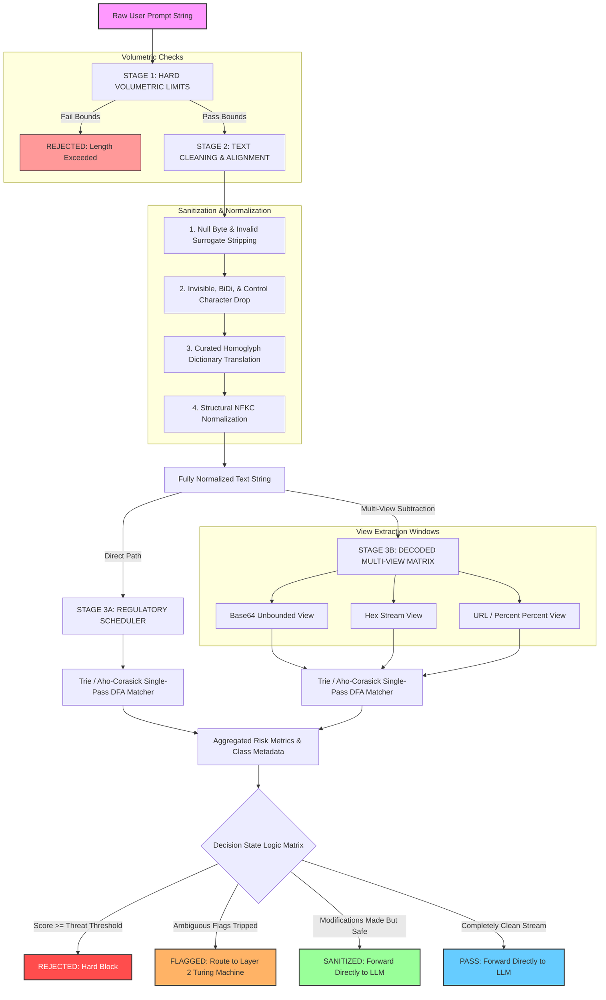

# Layer 1 Prompt Security Middleware Architecture

This document maps out the comprehensive, production-grade architecture of our **Layer 1 Guardrail Pipeline**. This layer serves as a high-speed, deterministic pre-filter designed to neutralize obfuscation tactics and flag suspicious prompt signatures before inputs are passed to downstream layers.

---

## 🏗️ System Architecture Overview

---

## ⚡ Step-by-Step Processing Pipeline

### STAGE 1: HARD VOLUMETRIC LIMITS
* **Length Check:** Inspects the raw stream length against a maximum character threshold (`max_length`). If boundaries are broken, the prompt drops immediately without executing resource-heavy text parsers.

### STAGE 2: TEXT CLEANING & ALIGNMENT
* **Null Byte Stripping:** Eliminates structural break attempts (`\x00`).
* **Control Filter:** Strips hidden tokens, format markers (`Cf`), bidirectional text overrides (`BiDi`), and basic control codes (`Cc`).
* **Homoglyph Flattening:** Evaluates a curated character-mapping index to translate visually look-alike script variants (such as Cyrillic/Greek replacements) back to native ASCII values.
* **NFKC Normalization:** Applies Unicode Compatibility Decomposition to crush stylistic formatting exploits (like mathematical bold strings `𝐦𝐚𝐬𝐭er`) into unified tokens.

### STAGE 3: RECOGNITION (THE TRIE DFA MATCHING ENGINE)
The normalized main prompt and extracted bounded window views (Base64, Hex, URL) run through a high-performance **Aho-Corasick / Trie Finite Automaton Engine**:
1. **Single-Pass Parsing ($O(N)$ Complexity):** Scans each string exactly once, independent of the underlying dataset dictionary scale.
2. **Database Separation:** Suspicious words live in clean external JSON/database definitions (`[Word, Classification, Threat Score]`), allowing hot updates to the filter library without modifying pipeline script infrastructure.

---

## 📋 Multi-State Output Tiers

| Classification State | System Security Routing Behavior |
| :--- | :--- |
| **`REJECTED`** | Volumetric limits violated or maximum aggregated threat score hits the fatal boundary block threshold. Input dropped. |
| **`FLAGGED`** | Ambiguous security rule signatures hit intermediate weights. Sent to **Layer 2 (Turing Machine/LLM Evaluator)** for semantic evaluation. |
| **`SANITIZED`** | Structural obfuscations or homoglyphs were cleaned, but no active injection signatures were flagged. Safely passed directly to core LLM. |
| **`PASS`** | Clean prompt validation stream. Sent straight to the core LLM execution engine. |
